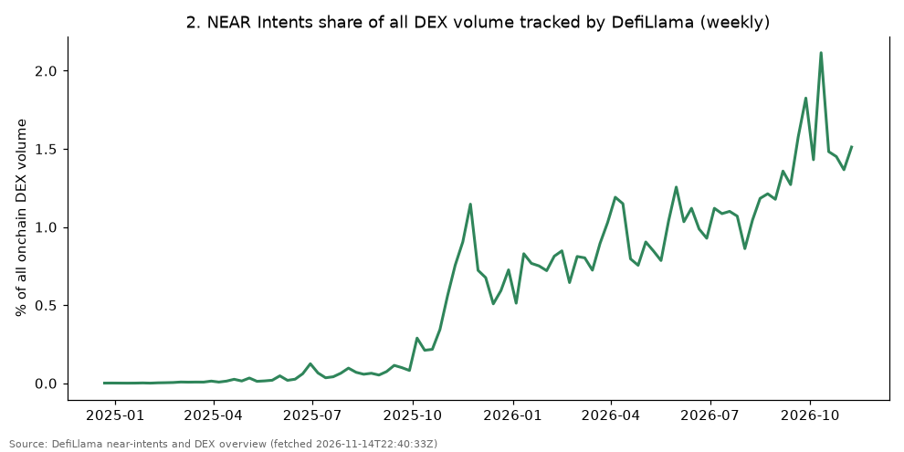

# NEAR Settlement Thesis

**In plain words:** people now use NEAR Intents to move and swap money across many blockchains, and that use keeps growing whether the NEAR price goes up or down. But very little of that money reaches NEAR holders yet. This project checks both statements against public data, shows the evidence for and against, and lets anyone rebuild every chart with one command.

* Thesis with every number linked to its source: [THESIS.md](THESIS.md)
* Live page: https://henrysammarfo.github.io/near-settlement-thesis/
* Built for NEAR HACKATHON 2026, track `thesis`. Not financial advice.

Headline results (current build, see THESIS.md for links): weekly Intents volume changes correlate -0.05 with NEAR price changes; Intents share of all onchain DEX volume rose from 0.003% to 1.46% (first versus latest 13 weeks); NEAR's market cap is 477x yearly Intents revenue.

## Other project by the same builder

Henry Sam Marfo also submitted **Pocket** (https://github.com/henrysammarfo/pocket), a separate and independent project, as required by HACKATHON.md Q-015.

## For reviewers: do X, see Y

Needs Python 3.10 or newer. No API keys. No cost.

1. `git clone https://github.com/henrysammarfo/near-settlement-thesis && cd near-settlement-thesis`
2. `python3 -m venv .venv && .venv/bin/pip install -r requirements.txt` (or `npm run setup`). You see matplotlib, pandas, numpy and pytest install.
3. `npm run rebuild` (or `sh rebuild.sh`, or `make rebuild`). You see one line per source, for example `intents_volume: 704 rows`, then `rendered THESIS.md and site/index.html`. This refetches all data into `data/`, recomputes `results/results.json`, redraws all six charts in `charts/` and rewrites `THESIS.md` and `site/index.html`.
4. `npm test` (or `.venv/bin/python -m pytest -q`). You see `4 passed`. The tests check that every CSV has rows, sorted unique dates, a fetch time and a source URL, and that deleting the charts and rebuilding brings all six back with a complete THESIS.md.
5. Open `site/index.html` in a browser. You see the thesis with all charts.
6. To check one number, open `results/results.json`, find the key, and compare with the CSV in `data/` named after it. Every CSV row carries `source_url` and `fetched_at_utc`.

## Data sources (free path, used)

| File | Source |
|---|---|
| data/intents_volume.csv | DefiLlama, NEAR Intents daily volume |
| data/intents_fees.csv, data/intents_revenue.csv | DefiLlama, NEAR Intents daily fees and revenue |
| data/all_dex_volume.csv | DefiLlama, all onchain DEX volume |
| data/near_chain.csv | NearBlocks charts API: transactions, active accounts, fees, price, market cap |
| data/near_stablecoins.csv, data/near_tvl.csv | DefiLlama stablecoins and TVL on NEAR |
| data/near_price.csv, data/btc_price.csv | CoinGecko, 365 days |

**BigQuery is the optional path.** The track prompt suggests the NEAR BigQuery public dataset and the Intents Explorer API. BigQuery bills whoever runs the query and the Explorer needs a partner token, so this build uses only the free sources above. `docs/BIGQUERY.md` lists the queries we would add with billing.

## How it is built

* `scripts/fetch.py` pulls the data. `scripts/build.py` computes every number and chart. `scripts/render.py` fills `scripts/THESIS.template.md` and writes the site. No number in THESIS.md is typed by hand.
* Falsifiers are fixed in `scripts/build.py` and reported in THESIS.md whether or not they help the claim.
* The live page is `site/`, published with GitHub Pages.

## License

MIT, see LICENSE.
