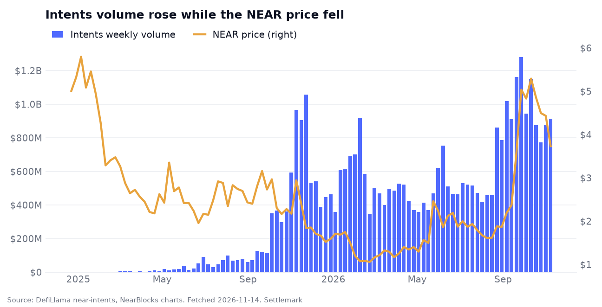

<p align="left"></p>

# Settlemark research note 01: the NEAR settlement thesis

**In plain words:** people now use NEAR Intents to move and swap money across many blockchains, and that use keeps growing whether the NEAR price goes up or down. But very little of that money reaches NEAR holders yet. This project tests both statements against public data, gives the evidence against as much room as the evidence for, and lets anyone rebuild every number and chart with one command.

* Live page: https://near-settlement-thesis.vercel.app/ (the committed [site/](site/) folder, with interactive charts drawn from [site/data.json](site/data.json); the first version stays at /v1)
* The thesis, every number linked to its source: [THESIS.md](THESIS.md)
* Built for NEAR HACKATHON 2026, track `thesis`. Not financial advice.

## After the deadline (14 Nov 2026 23:59 UTC)

The version submitted before the deadline is commit [7ee8b43](https://github.com/henrysammarfo/near-settlement-thesis/tree/7ee8b43f587a4c649acc58995d54ad756e4a45c5). That copy still works and can be tested on its own: check out that commit, run `npm run setup` and `npm test`, and open `site/index.html`. If you score only the deadline version, you can ignore the commits listed here. The live page above now serves the later work, after this merge, so use the commit link (not the live page) when you want the submitted copy.

These commits were added after the cutoff (14 Nov 2026 23:59 UTC):

* [`d2f2be3`](https://github.com/henrysammarfo/near-settlement-thesis/commit/d2f2be3) 2026-11-15 07:03 UTC. BigQuery query 05 committed (100 weeks, 65.09 GB, console 2026-11-15T06:58:10Z): lead test and out of sample check rerun on it, cross check against NearBlocks; query 04 pending until the quota resets on 1 Dec
* [`9fa3626`](https://github.com/henrysammarfo/near-settlement-thesis/commit/9fa3626) 2026-11-15 06:17 UTC. Lead test: out of sample check (fit on first 70 weeks, forecast the last 28, Clark West p), on page and thesis, with tests
* [`c540a43`](https://github.com/henrysammarfo/near-settlement-thesis/commit/c540a43) 2026-11-15 06:11 UTC. Persona fixes: native lead and take rate charts, honest noise band counts, inlined fonts for file://, mobile table, methodology caveats, README preview link
* [`671edfa`](https://github.com/henrysammarfo/near-settlement-thesis/commit/671edfa) 2026-11-15 05:59 UTC. Test the track hypothesis (Intents leads usage: not supported), compare five cross chain routers, make BigQuery a main source with committed results, anchor bolder predictions on NEAR testnet, and make site/index.html work from disk
* [`cfee25b`](https://github.com/henrysammarfo/near-settlement-thesis/commit/cfee25b) 2026-11-15 05:37 UTC. Silence all 100 deprecation warnings at the source: explicit day units instead of pd.Timedelta, pandas 3 required, warnings are now test errors
* [`753ac09`](https://github.com/henrysammarfo/near-settlement-thesis/commit/753ac09) 2026-11-15 00:33 UTC. Thesis tester with live sliders, raw chain, valuation, robustness and predictions sections, three new charts, python -m settlemark check, optional BigQuery runner
* [`0339000`](https://github.com/henrysammarfo/near-settlement-thesis/commit/0339000) 2026-11-15 00:33 UTC. Freeze eight falsifiable predictions for the 4 and 8 weeks after 2026-11-15, with our probabilities and a published sha256
* [`47809a9`](https://github.com/henrysammarfo/near-settlement-thesis/commit/47809a9) 2026-11-15 00:33 UTC. Raw chain evidence from NEAR archival RPC (one block a week: supply, buyback wallet, intents.near storage), a buyback DCF valuation and robustness checks

## Headline results

Numbers from the current build, stored in [results/results.json](results/results.json). They change only when the public data changes. See [THESIS.md](THESIS.md) for the write up. `npm run check` rebuilds from the committed CSVs and fails if these numbers drift from the code.

| Question | Answer | Where to check |
|---|---|---|
| Does Intents usage move with the NEAR price? | No. Weekly log changes correlate at about zero (`corr_weekly_change_intents_vs_near_price` in results.json). The 90% bootstrap interval is in [THESIS.md](THESIS.md). | [settlemark/stats.py](settlemark/stats.py), [settlemark/analysis.py](settlemark/analysis.py), [tests/test_stats.py](tests/test_stats.py), [data/intents_volume.csv](data/intents_volume.csv), [data/near_chain.csv](data/near_chain.csv) |
| Is Intents taking share of onchain trading? | Yes. Its share of all DEX volume rose from almost nothing (`share_first_13w_pct`) to over 1% (`share_last_13w_pct`). | [settlemark/analysis.py](settlemark/analysis.py), [data/intents_volume.csv](data/intents_volume.csv), [data/all_dex_volume.csv](data/all_dex_volume.csv) |
| Do holders capture the flow? | Not yet. NEAR's market cap is hundreds of times yearly Intents revenue (`mcap_to_intents_revenue`). | [settlemark/analysis.py](settlemark/analysis.py), [data/near_chain.csv](data/near_chain.csv), [data/intents_revenue.csv](data/intents_revenue.csv) |
| How many of our five falsifiers are met? | None of the five are met in the current build (`falsifiers` in results.json, each `"met": false`). | [settlemark/analysis.py](settlemark/analysis.py), [settlemark.toml](settlemark.toml) (`[falsifiers]`), [THESIS.md](THESIS.md) |
| Do buybacks offset new NEAR supply? | No. Read from NEAR archival RPC: buybacks catch most Intents revenue (`chain.buyback_share_of_revenue_13w_pct`) but cover under a fifth of new supply (`chain.buyback_coverage_13w_pct`). | [settlemark/chain.py](settlemark/chain.py), [settlemark/deep.py](settlemark/deep.py), [data/near_rpc.csv](data/near_rpc.csv), [data/intents_revenue.csv](data/intents_revenue.csv) |
| What are buybacks worth per token? | Well below the price in the base case. The page tester uses the same formulas. | [settlemark/valuation.py](settlemark/valuation.py), [templates/model.js](templates/model.js), [tests/test_valuation.py](tests/test_valuation.py), [tests/test_model_js.py](tests/test_model_js.py) |
| Does Intents volume lead network usage (the track's hypothesis)? | No, not on public data, in sample or out of sample. Granger style tests on five usage series, including raw chain state and BigQuery weekly signers, find no lead at the 5% level (`leadlag.series_where_intents_leads` is empty; `leadlag.min_headline_p` is above 0.05). Fitting on the first 70 weeks then forecasting the last 28 gives the same answer (`leadlag.series_where_oos_helps` is empty). BigQuery weekly distinct signers fell 92% from the first 13 weeks to the last 13 (`bigquery.weekly.signers_change_pct`, about 2.32M to 179K a week). Reported as a null result. | [settlemark/leadlag.py](settlemark/leadlag.py), [tests/test_leadlag.py](tests/test_leadlag.py), [data/bigquery/05_weekly_activity.csv](data/bigquery/05_weekly_activity.csv), [queries/05_weekly_activity.sql](queries/05_weekly_activity.sql), [THESIS.md](THESIS.md) |
| How does Intents compare with other cross chain routers? | Largest of five by volume, mid priced on fees, and NEAR trades at about 15x the revenue multiple of router tokens (`peers` in results.json). | [settlemark/peers.py](settlemark/peers.py), [tests/test_peers.py](tests/test_peers.py), [data/peers/](data/peers/) |
| What do we expect next? | Fourteen predictions with probabilities: eight in [data/predictions.json](data/predictions.json) and six in [data/predictions_2.json](data/predictions_2.json), written up in [PREDICTIONS.md](PREDICTIONS.md) and [PREDICTIONS_2.md](PREDICTIONS_2.md). They were frozen after the hackathon deadline but before any scored week. Both hashes are anchored on NEAR testnet. | [settlemark/predictions.py](settlemark/predictions.py), [tests/test_predictions.py](tests/test_predictions.py), [settlemark/anchor.py](settlemark/anchor.py), [tests/test_anchor.py](tests/test_anchor.py), [data/anchors.json](data/anchors.json) |



## Other project by the same builder

Henry Sam Marfo also submitted **Pocket** (https://github.com/henrysammarfo/pocket), a separate and independent project, as required by [HACKATHON.md Q-015](https://nearhackathon.com/HACKATHON.md).

## For reviewers: do X, see Y

Needs Python 3.11 or newer. No API keys. No accounts. No cost.

1. `git clone https://github.com/henrysammarfo/near-settlement-thesis && cd near-settlement-thesis`
2. `npm run setup` (or `make setup`). You see the Python packages install into `.venv`.
3. `npm run rebuild` (or `sh rebuild.sh`, or `make rebuild`). You see one log line per dataset with its row count (for example the committed [data/intents_volume.csv](data/intents_volume.csv)), then [data/near_rpc.csv](data/near_rpc.csv) (101 weekly samples), one line per router series in [data/peers/](data/peers/), [results/results.json](results/results.json), `charts: 44 files` (11 PNGs in [charts/](charts/) plus 11 PNGs and 22 SVGs in [site/charts/](site/charts/)) and a rendered [THESIS.md](THESIS.md). BigQuery is read from the committed results in [data/bigquery/](data/bigquery/), so no Google account is needed. The first run takes a few minutes because it reads one archival block a week; [settlemark/chain.py](settlemark/chain.py) prints the RPC call count on the `near_rpc` log line. Later runs reuse the immutable block cache and take seconds.
4. `npm test` (or `make test`). You see `89 passed` (the collected tests under [tests/](tests/); `pytest --collect-only -q` lists them) and no warnings. Deprecation and future warnings are test errors, set in [pyproject.toml](pyproject.toml). No network is needed (the JavaScript model test in [tests/test_model_js.py](tests/test_model_js.py) needs Node).
5. `make lint`. You see ruff report no problems, using the rules in [pyproject.toml](pyproject.toml).
5b. `npm run check` (or `python -m settlemark check`). It rebuilds every output into a temp folder from the committed CSVs and fails on any byte of difference, then audits THESIS.md so every number is either computed or a constant written in the template ([settlemark/check.py](settlemark/check.py), [tests/test_check.py](tests/test_check.py)).
6. Open [site/index.html](site/index.html) straight from disk (double click, or `file://`). You see the same page as the live site with every chart drawn: the chart data is inlined in the HTML ([tests/test_site_offline.py](tests/test_site_offline.py)). If you prefer a server, `npm run serve` serves `site/` at http://localhost:8000.
6b. `npm run anchor` (needs network). It fetches the NEAR testnet transaction that holds the prediction hashes and checks them against the committed files ([settlemark/anchor.py](settlemark/anchor.py)). `python -m settlemark anchor show` does the same offline from the committed RPC response in [data/anchors/](data/anchors/).
7. To check any number: find its key in [results/results.json](results/results.json), look up which CSV it came from in the `provenance` block of the same file, and open that CSV in [data/](data/). Every row carries its `source_url` and `fetched_at_utc`.

The live page is the committed `site/` folder, served as a static site ([vercel.json](vercel.json)). A git push does not rerun the Python build on Vercel.

## How it is built

```
settlemark.toml        every tunable: windows, bootstrap seed, falsifier thresholds, source URLs
settlemark/
  http.py              JSON fetch with retries, exponential backoff, no retry on 4xx, and a local cache
  sources.py           the nine datasets (DATASETS in this file): URL, parser and schema for each; atomic CSV writes
  schema.py            validation: header, ISO dates sorted and unique, finite numbers, bounds, provenance
  fetch.py             fetch, validate and write every dataset
  stats.py             Pearson correlation, bootstrap interval, lead and lag, log changes, weekly resampling
  analysis.py          every number and the five falsifiers, with provenance for each key
  chain.py             NEAR archival RPC sampler: one block per week (interpolation search), supply,
                       buyback wallet balance and intents.near storage, immutable on disk cache
  deep.py              raw chain metrics, the valuation inputs and the robustness checks
  valuation.py         DCF of holder cash flow, reverse DCF and break even volume
  predictions.py       freeze predictions once, score them after their windows close (Brier score)
  check.py             byte for byte rebuild check and the THESIS.md number audit
  bigquery.py          BigQuery as a main source: committed results, a manifest with scan size and SQL hash,
                       an API runner with a dry run and a scan limit, and an importer for console downloads
  leadlag.py           does Intents volume lead usage? cross correlations, Granger F tests, a circular shift test, an out of sample check
  peers.py             Intents against THORChain, Chainflip, LI.FI and Rango: volume, fees, revenue, capture
  anchor.py            prediction hashes anchored on NEAR testnet, verified offline and live
  charts.py            eleven charts in light and dark, deterministic output (no timestamps embedded)
  render.py            THESIS.md, the live page and site/data.json for its interactive charts
templates/app.js       the page script: hand written SVG charts with tooltips, reveals, counters and the thesis tester
templates/model.js     the tester's model, the browser twin of valuation.py (a test runs it in Node)
  __main__.py          the command line: python -m settlemark fetch | build | rebuild | check | predictions | bigquery | bigquery-import | anchor
templates/             THESIS.md and page templates (no numbers in them, only placeholders)
brand/                 the Settlemark mark and wordmark, hand written SVG
tests/                 unit tests for the statistics, schema, parsers and HTTP layer, plus integration tests
queries/, docs/        BigQuery SQL and how to refresh it
contracts/anchor/      a small NEAR testnet contract, with no SDK, that logs the prediction hashes (source in contracts/anchor/src/lib.rs). A compiled wasm is not committed, so this README does not claim a byte size.
```

Design choices that matter for a thesis:

* **Weekly changes, not levels.** Two trending series always look correlated. We correlate weekly log changes, and report the levels correlation separately as evidence against. Code: [settlemark/stats.py](settlemark/stats.py), [settlemark/analysis.py](settlemark/analysis.py). Tests: [tests/test_stats.py](tests/test_stats.py).
* **Uncertainty is shown.** The main correlation comes with a 90% bootstrap interval (2,000 resamples, fixed seed in [settlemark.toml](settlemark.toml), so it repeats exactly). Code: [settlemark/stats.py](settlemark/stats.py). Tests: [tests/test_stats.py](tests/test_stats.py).
* **Falsifiers are code.** Five tests that would prove the thesis wrong are checked on every rebuild and shown whether or not they help. Code: [settlemark/analysis.py](settlemark/analysis.py), thresholds in [settlemark.toml](settlemark.toml).
* **Raw chain, not only aggregators.** Supply, buybacks and Intents contract state come from NEAR archival RPC, one block a week, each with its block hash so any node can confirm it. Code: [settlemark/chain.py](settlemark/chain.py). Data: [data/near_rpc.csv](data/near_rpc.csv). Tests: [tests/test_chain.py](tests/test_chain.py).
* **Predictions written in advance.** [data/predictions.json](data/predictions.json) (set 1, eight items) and [data/predictions_2.json](data/predictions_2.json) (set 2, six items, bolder) were frozen with thresholds and our probabilities before any scored week began, though after the hackathon deadline. Their sha256 values are published in the PREDICTIONS files, anchored in [a NEAR testnet transaction](https://testnet.nearblocks.io/txns/6TD8srdoYvPsuYohetnnvgcFPt8PdjhyW739wTfpdpqN), and a test fails if either file changes ([tests/test_predictions.py](tests/test_predictions.py), [tests/test_anchor.py](tests/test_anchor.py)).
* **The track's hypothesis is tested, and it fails.** Intents volume does not lead NearBlocks accounts, transactions or the raw state of `intents.near`, in sample or out of sample, and it does not lead BigQuery weekly signers either. We report the null result in full. Code: [settlemark/leadlag.py](settlemark/leadlag.py). Tests: [tests/test_leadlag.py](tests/test_leadlag.py). Data: [data/near_chain.csv](data/near_chain.csv), [data/near_rpc.csv](data/near_rpc.csv), [data/bigquery/05_weekly_activity.csv](data/bigquery/05_weekly_activity.csv).
* **Peers, not just ratios.** The same DefiLlama source and window for five cross chain routers, so take rates and market cap to revenue are compared like for like. Code: [settlemark/peers.py](settlemark/peers.py). Data: [data/peers/](data/peers/). Tests: [tests/test_peers.py](tests/test_peers.py).
* **A valuation, not just a ratio.** Only buybacks measured on chain count as holder cash. Growth scenarios come from the data, not from us, and the page tester runs the same formulas. Code: [settlemark/valuation.py](settlemark/valuation.py), [templates/model.js](templates/model.js). Tests: [tests/test_valuation.py](tests/test_valuation.py), [tests/test_model_js.py](tests/test_model_js.py).
* **No hand typed numbers.** Templates hold placeholders only. A test recomputes key numbers straight from the CSVs, another checks that two builds produce byte identical files, and another checks the committed results match a fresh build. Code: [settlemark/check.py](settlemark/check.py), [settlemark/render.py](settlemark/render.py). Tests: [tests/test_check.py](tests/test_check.py), [tests/test_pipeline.py](tests/test_pipeline.py).

## Data sources

| File | Source |
|---|---|
| [data/intents_volume.csv](data/intents_volume.csv) | DefiLlama, NEAR Intents daily volume ([URL in settlemark.toml](settlemark.toml)) |
| [data/intents_fees.csv](data/intents_fees.csv), [data/intents_revenue.csv](data/intents_revenue.csv) | DefiLlama, NEAR Intents daily fees and revenue |
| [data/all_dex_volume.csv](data/all_dex_volume.csv) | DefiLlama, all onchain DEX volume |
| [data/near_chain.csv](data/near_chain.csv) | NearBlocks charts API: transactions, active accounts, fees, price, market cap |
| [data/near_stablecoins.csv](data/near_stablecoins.csv), [data/near_tvl.csv](data/near_tvl.csv) | DefiLlama stablecoins and TVL on NEAR |
| [data/near_price.csv](data/near_price.csv), [data/btc_price.csv](data/btc_price.csv) | CoinGecko, 365 days |
| [data/near_rpc.csv](data/near_rpc.csv) | NEAR archival RPC (FastNEAR, NEAR Foundation node as fallback): block, supply, buyback wallet, intents.near storage, weekly |
| [data/peers/*.csv](data/peers/) | DefiLlama volume, fees and revenue for THORChain, Chainflip, LI.FI and Rango; CoinGecko market caps for RUNE and FLIP |
| [data/bigquery/*.csv](data/bigquery/), [manifest.json](data/bigquery/manifest.json) | NEAR BigQuery public dataset, committed with scan size, run time and SQL hash |
| [data/predictions.json](data/predictions.json), [data/predictions_2.json](data/predictions_2.json) | our predictions, frozen 2026-11-15 |
| [data/anchors.json](data/anchors.json), [data/anchors/](data/anchors/) | the NEAR testnet transaction holding the prediction hashes, and its raw RPC response |

**BigQuery is a main source, with committed results.** The track suggests the NEAR BigQuery public dataset. Every BigQuery result the thesis uses is committed in [data/bigquery/](data/bigquery/) with a manifest that records the bytes scanned, when it ran and a hash of its SQL, so a fresh clone with no Google account still rebuilds byte for byte, and `npm run check` fails if a query changes after its result was made. How to refresh: [docs/BIGQUERY.md](docs/BIGQUERY.md). `npm run bigquery` refreshes them with a Google account (dry run first, refuses anything above the limit in [settlemark.toml](settlemark.toml)), and `python -m settlemark bigquery-import 05 download.csv --scanned-gb N` takes a CSV downloaded from the BigQuery console. Query `05` ([queries/05_weekly_activity.sql](queries/05_weekly_activity.sql), weekly NEAR transactions and distinct signers, 100 weeks, 65.09 GB scanned in the console on 15 Nov, run at 2026-11-15T06:58:10Z per [data/bigquery/manifest.json](data/bigquery/manifest.json)) is committed in [data/bigquery/05_weekly_activity.csv](data/bigquery/05_weekly_activity.csv) and feeds the lead and lag test. Its transactions match NearBlocks almost exactly (`bigquery.weekly.tx_change_corr`), and its signers fell 92% from the first 13 weeks to the last 13 (`bigquery.weekly.signers_change_pct`), which confirms the base chain decline. Query `04` ([queries/04_intents_weekly.sql](queries/04_intents_weekly.sql), weekly Intents receipts and senders) is pending: the console estimated about 500 GB, more than was left of the free monthly quota, so it waits until the quota resets on 1 Dec. Nothing was done to get around the quota. The Intents Explorer API needs a partner token and was not used.

## Brand

The Settlemark mark shows three lines from different chains meeting in one point and settling into a single dot. Ink `#0B1020`, signal blue `#3D5AFE`, settled green `#3DD6A3`, with red `#E5484D` kept for evidence against. Files: [brand/mark.svg](brand/mark.svg), [brand/wordmark.svg](brand/wordmark.svg).

## License

MIT, see [LICENSE](LICENSE).
