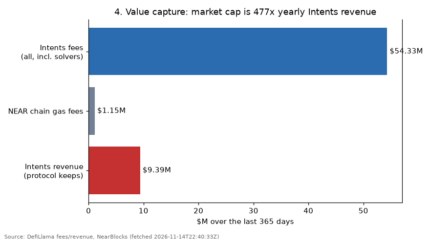
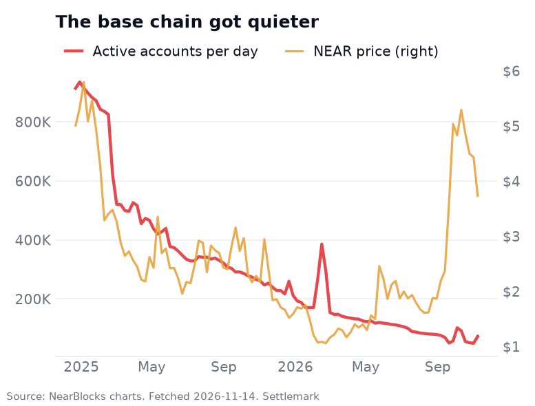
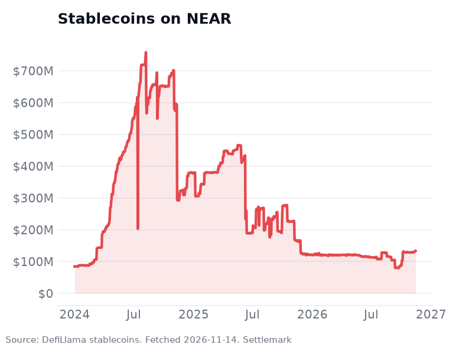
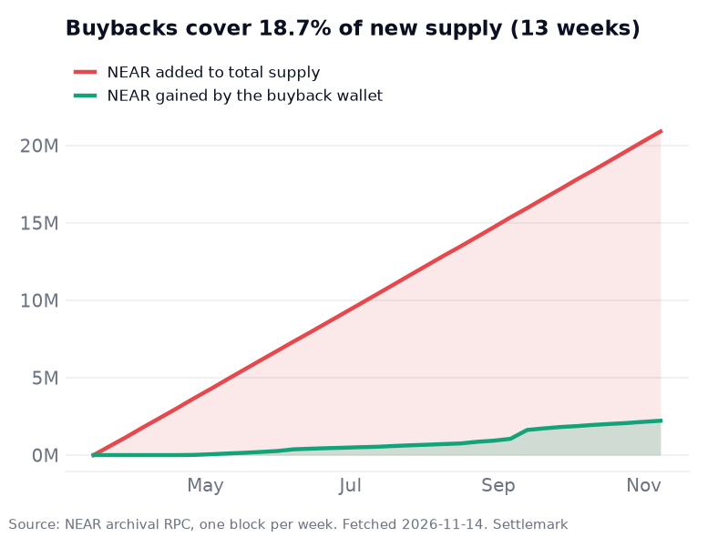
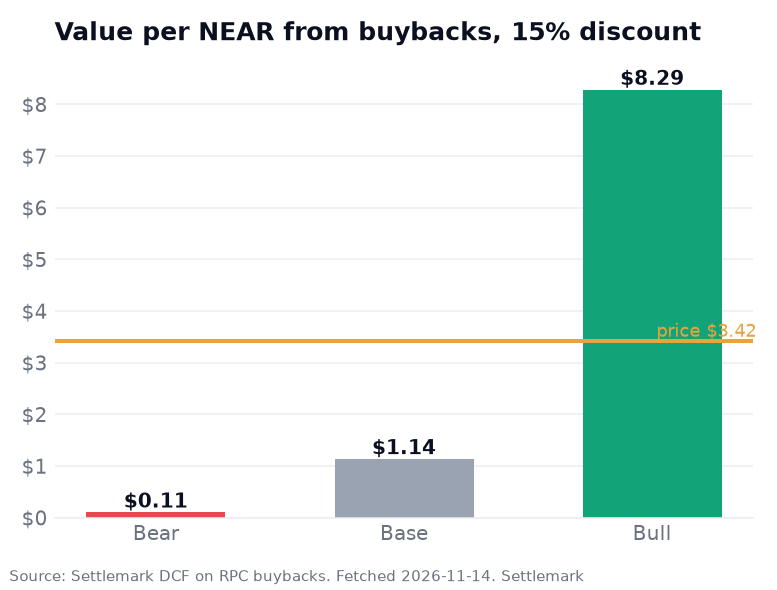
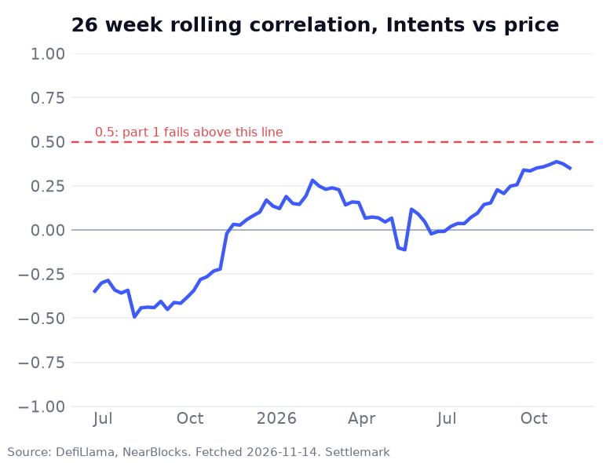
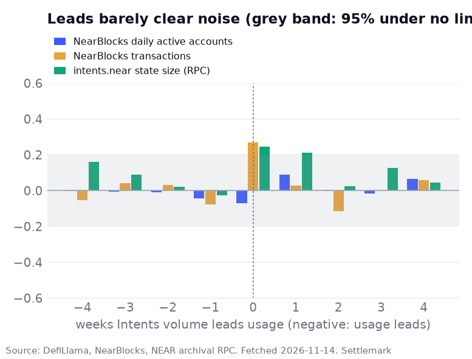
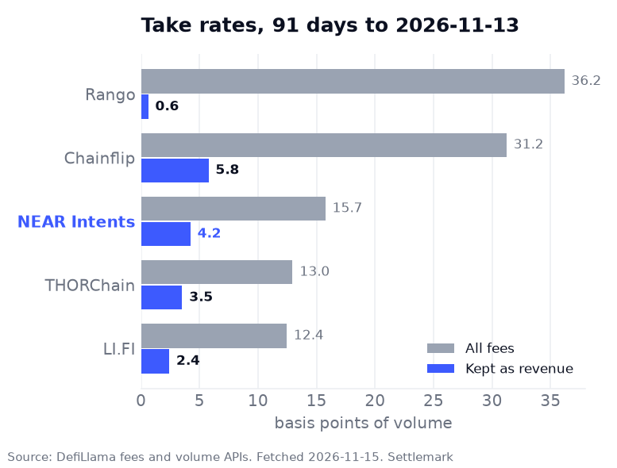

# Settlemark THESIS: NEAR is becoming a settlement layer, and its token has not caught up

Every number below is computed by `settlemark/analysis.py` and `settlemark/deep.py` from the validated CSV files in `data/` and written into this file by `settlemark/render.py` (run `npm run rebuild`). Each linked number points at the public API it came from. Data fetched 2026-11-14T23:05:20Z. Window: 2024-12-10 to 2026-11-13 (99 full weeks). Not financial advice.

## The claim

NEAR Intents has turned NEAR into a cross chain settlement layer whose usage grows on its own, independent of the NEAR price. The long term case for NEAR rests on that flow. The weak point today is that the token captures very little of it.

Two parts, tested separately:

1. **Usage is independent of price.** If Intents were just NEAR speculation, its weekly volume would rise and fall with the NEAR price. We expect it not to.
2. **Value capture is small.** The flow is large next to the fees that reach the network and its holders.

## Evidence for

- Weekly NEAR Intents volume went from [$0.8M](https://api.llama.fi/summary/dexs/near-intents?dataType=dailyVolume) a week (first 4 weeks) to [$859.7M](https://api.llama.fi/summary/dexs/near-intents?dataType=dailyVolume) a week (last 4 weeks). Over the same span the NEAR price went from [$5.30](https://api.nearblocks.io/v1/charts) to [$4.38](https://api.nearblocks.io/v1/charts). 
- Intents share of all onchain DEX volume tracked by DefiLlama: [0.003%](https://api.llama.fi/overview/dexs?excludeTotalDataChartBreakdown=true&excludeTotalDataChart=false) in the first 13 weeks, [1.03%](https://api.llama.fi/overview/dexs?excludeTotalDataChartBreakdown=true&excludeTotalDataChart=false) in the 13 weeks before the latest, [1.46%](https://api.llama.fi/overview/dexs?excludeTotalDataChartBreakdown=true&excludeTotalDataChart=false) in the latest 13 weeks. 
- Correlation between weekly changes in Intents volume and weekly NEAR price changes is [-0.05](https://api.llama.fi/summary/dexs/near-intents?dataType=dailyVolume) over 99 weeks (90% bootstrap interval -0.21 to +0.12). That is close to zero. 
- Neither leads the other: last week's NEAR price change against this week's Intents change gives +0.06, and the reverse gives +0.05.
- It is not just crypto beta either: correlation of weekly Intents changes with Bitcoin weekly returns is [-0.08](https://api.coingecko.com/api/v3/coins/bitcoin/market_chart?vs_currency=usd&days=365&interval=daily) over 51 weeks. It does follow the overall DEX market somewhat ([+0.34](https://api.llama.fi/overview/dexs?excludeTotalDataChartBreakdown=true&excludeTotalDataChart=false)), which is what a settlement venue should do.
- Over the last 365 days Intents settled [$32.97B](https://api.llama.fi/summary/dexs/near-intents?dataType=dailyVolume) and charged [$54.3M](https://api.llama.fi/summary/fees/near-intents?dataType=dailyFees) in total fees.

## Evidence against

- **Holders capture little.** Over the last 365 days the Intents protocol kept [$9.4M](https://api.llama.fi/summary/fees/near-intents?dataType=dailyRevenue) as revenue (about 2.8 basis points of volume; all fees were 16.5 basis points). NEAR chain gas fees were [$1.1M](https://api.nearblocks.io/v1/charts). NEAR's market cap is [$4.48B](https://api.nearblocks.io/v1/charts): 477x yearly Intents revenue and 3,906x yearly chain fees. 
- **Levels point the wrong way for holders.** The correlation of log weekly Intents volume with log NEAR price is [-0.52](https://api.nearblocks.io/v1/charts): usage grew while the price fell. Usage alone has not supported the price.
- **The base chain shrank while Intents grew.** NearBlocks daily active accounts averaged [775,618](https://api.nearblocks.io/v1/charts) in the first 13 weeks of the window and [70,872](https://api.nearblocks.io/v1/charts) in the latest 13 weeks. Part of that drop may be bot or airdrop traffic leaving, and relayed signers are undercounted, but it is not the picture of a busier chain. Weekly changes correlate [-0.12](https://api.nearblocks.io/v1/charts) with price changes. 
- **Stablecoins on NEAR shrank:** [$164.5M](https://stablecoins.llama.fi/stablecoincharts/Near) a year ago, [$133.4M](https://stablecoins.llama.fi/stablecoincharts/Near) now. A settlement layer for money should hold more dollars, not fewer. 
- **The recent rally broke the pattern for a quarter.** Over the latest 13 weeks the NEAR price moved 132% and Intents volume 85% (4 week averages), and the weekly change correlation in those 13 weeks alone was +0.54, above the 0.5 line. The 26 week test below still holds, but this is the first sign that usage and price may be moving together. Prediction P3 tests it.
- Volume counts can flatter. DefiLlama may count both legs or confidential flow; another entry in this track, [near-thesis](https://github.com/soldanoandrea/near-thesis), found public swaps match only part of DefiLlama's reported volume on sampled days. Our share numbers inherit that.

## Raw chain evidence: read from NEAR itself

Aggregators can be wrong, so the core supply and buyback facts are read straight from NEAR archival RPC: one block per week, the first block at or after Monday 00:00 UTC, 101 blocks from height 134,545,755 to 223,688,383 ([data/near_rpc.csv](data/near_rpc.csv)). Each row stores the block hash, so anyone can check it against any NEAR node. Code: `settlemark/chain.py`.

- **New supply.** Total NEAR supply is [1.3112B NEAR](data/near_rpc.csv). It grew by [31.64M NEAR](data/near_rpc.csv) (2.47%) in the last 52 weeks and 8.02M NEAR in the last 13. Issuance is the cost every holder pays.
- **Buybacks are real and measurable.** The wallet `buybacks.multisignature.near` first held NEAR in the week of 2026-03-22 and holds [2.22M NEAR](data/near_rpc.csv) now. It gained [1.50M NEAR](data/near_rpc.csv) in the last 13 weeks, worth $4.7M at each week's price. Intents revenue over the same weeks was $5.0M by DefiLlama, so about 94% of reported revenue turns into NEAR bought for holders. The two series line up closely, which suggests DefiLlama's revenue figure tracks this buyback flow. The wallet balance fell in 0 sampled weeks, so no NEAR left it and the weekly gains are buybacks, not round trips.
- **But buybacks cover only 18.7% of new supply** over the last 13 weeks. Net supply still grows: holder capture is real but not yet enough to shrink the float. 
- **Usage inside the protocol grew on chain.** The `intents.near` contract stores [13.49 GB](data/near_rpc.csv) of state, up from 3.39 GB a year ago (4.0x). Weekly growth in that storage correlates -0.06 with NEAR price changes and +0.25 with Intents volume changes over 98 weeks: a raw chain usage measure that does not follow price.
- **Cross checks.** Price times RPC supply gives a fully diluted value of $4.48B at $3.42; NearBlocks market cap is 100.0% of it, so the market cap used for F5 is consistent with the chain. On 6 days the BigQuery public dataset counts 4.6 to 5.2 receipt actions per NearBlocks transaction, so receipts are not a substitute for transactions in trend work.

## Valuation: what the buybacks are worth

Only cash that reaches holders counts: the buybacks measured on chain above, annualised from the last 13 weeks to [$18.8M](data/near_rpc.csv) a year. The model (`settlemark/valuation.py`) grows that cash for 5 years, fades growth to 3% over 5 more, and discounts at 15%. Growth is not typed by hand: the bull case is the observed annualised revenue growth of the last half year (746%) capped at 100%; base is half of that (50%); bear is no growth.

- Value per NEAR from buybacks: bear $0.11, base $1.14, bull $8.29, against a price of $3.42. Base is 33% of price; bull is 242%. 
- Reverse view: to justify today's $4.48B on buybacks alone, holder cash must grow about 76% a year for 5 years. Market value is 239x today's yearly holder cash flow.
- Break even: at the last 13 weeks' take rate (4.17 basis points) and buyback share, buybacks would match yearly issuance ($108.2M at today's price) once weekly Intents volume reaches $5.32B, 5.8x the recent average of $923.8M a week.
- Sensitivity, value per NEAR:

| Discount rate | Bear | Base | Bull |
|---|---|---|---|
| 10% | $0.18 | $2.33 | $18.06 |
| 15% | $0.11 | $1.14 | $8.29 |
| 20% | $0.08 | $0.69 | $4.68 |

The thesis tester on the page (`site/index.html`, section 04) runs the same formulas in the browser (`templates/model.js`) so you can move each assumption; a test checks both give the same numbers.

## Is part 1 robust?

- Split in half: -0.14 in the first half of the window, +0.21 in the second.
- Without the tiny first 13 weeks: -0.04 (90% interval -0.21 to +0.10). Rank (Spearman) correlation: -0.06.
- Every 26 week window: correlation ranges from -0.49 to +0.39 across 73 windows; 0 are above 0.5. 
- Latest 13 weeks alone: +0.54. That window is short, so it is a warning, not a verdict.

## Does Intents volume lead network usage?

The track asks whether cross chain volume through Intents is a better leading indicator of real network usage than the token price. Part 1 already shows price does not lead it. Here we test the leading part directly (`settlemark/leadlag.py`). Weekly log changes over 98 weeks. For each usage series, a Granger style F test asks whether the last 2 weeks of Intents changes improve a forecast of usage beyond usage's own past. A second, distribution free p value rotates the Intents series by every shift of at least 8 weeks, which keeps each series' own rhythm but breaks any real timing link. The lag order (2) was fixed in `settlemark.toml` before we looked; orders 1 to 4 are in `results/results.json`.

| Usage series | Weeks | Strongest lead (weeks, r) | p, Intents leads (2 lags) | Shift p | p, usage leads |
|---|---|---|---|---|---|
| NearBlocks daily active accounts | 98 | 1, +0.09 | 0.58 | 0.58 | 0.86 |
| NearBlocks transactions | 98 | 2, -0.11 | 0.48 | 0.54 | 0.79 |
| intents.near state size (RPC) | 98 | 1, +0.21 | 0.25 | 0.21 | 0.51 |

- **Result: Intents volume does not lead any usage series we can measure at p below 0.05.** The smallest headline p value is 0.25. For NearBlocks active accounts the strongest lead is 1 week at +0.09, inside the noise band, and the reverse test (usage leading Intents) gives 0.86. 
- **Read the chart with the band in mind.** The band is plus or minus 0.20, the 95% range for one correlation when there is no link. Bars at positive leads that cross it: 1 of 12 (intents.near state size (RPC) at 1 week, +0.21). Chance alone would put about 0.6 there. The joint tests above, which weigh all lags at once, are the ones to trust.
- **Same week is different: NearBlocks transactions +0.27, intents.near state size (RPC) +0.25.** Intents settles on NEAR, so a busy Intents week mechanically adds NEAR transactions and `intents.near` state in that same week. That is co-movement, partly by construction, not a lead.
- **So the track's hypothesis is not supported by these data.** Intents grew while base chain activity fell, and week to week the two move independently. That fits part 1 (Intents is its own flow), but it means Intents volume is not, on public data, an early signal of NEAR usage.
- Caveats: 24 tests were run, so one p value under 0.05 would be expected by chance; none came out that low. Two years of weekly data has low power, so a modest lead could exist and be missed. NearBlocks counts accounts, and relayers hide signers. A Granger test is about prediction, not cause. When the BigQuery weekly signer series lands (below), the same test runs on it automatically.

## Against other cross chain routers

The same source for everyone (DefiLlama's free fees and volume APIs), the same 91 days (2026-08-15 to 2026-11-13), 5 routers. Code: `settlemark/peers.py`; data: `data/peers/`.

| Router | Model | Volume | Fees, bps | Revenue, bps | Revenue share of fees | Market cap to yearly revenue |
|---|---|---|---|---|---|---|
| NEAR Intents | intents, solver auctions | $12.41B | 15.7 | 4.2 | 27% | 213x |
| THORChain | native asset pools | $6.51B | 13.0 | 3.5 | 27% | 21x |
| LI.FI | aggregator over other bridges | $4.12B | 12.4 | 2.4 | 19% | no token |
| Chainflip | native asset pools, JIT market makers | $2.06B | 31.2 | 5.8 | 18% | 8x |
| Rango | aggregator over other bridges | $0.92B | 36.2 | 0.6 | 2% | no token |

- Intents is the largest of the 5 by volume ($12.41B, 47.7% of the group). Its users pay 15.7 basis points in fees against a median of 22.1 for the other 4; it is cheaper than 2 of them. It keeps 4.2 basis points as revenue against a peer median of 3.0. 
- **The holder gap is the sharpest number in this note.** NEAR's market cap is 213x annualised Intents revenue; routers with their own token trade at a median 14x. NEAR is priced 15x richer per dollar of Intents revenue. Part of that is fair, since NEAR is a whole layer 1 and not only Intents, but it is the size of the bet a holder makes on Intents growth. Prediction P12 tests whether the gap persists.
- Caveats: each number follows that protocol's DefiLlama methodology, and they differ. Intents fees are the protocol fee plus the affiliate fee each frontend charges; Intents revenue is NEAR swept into NEAR's revenue wallets (the same flow `revenue.near.org` and the buyback show). THORChain fees include liquidity provider fees, outbound fees and affiliate fees; LI.FI and Rango are aggregators that route over other bridges, possibly including NEAR Intents, so volumes can overlap. Only routers with daily volume and fees on the free API are in; Relay, Across and deBridge publish fees there, but their volume needs a paid key.

## Data from the NEAR BigQuery public dataset

BigQuery is a main source, not an add on. Every result is committed in `data/bigquery/` with a manifest recording the bytes scanned, when it ran and a hash of its SQL (`settlemark/bigquery.py`). The rebuild reads the committed files, so a fresh clone with no Google account rebuilds byte for byte; `npm run bigquery` refreshes them with a Google account, dry running first and refusing any query above the limit in `settlemark.toml`. `python -m settlemark check` fails if a required result is missing or if its SQL changed after it ran.

| Query | Result | Rows | Scanned | Run |
|---|---|---|---|---|
| [queries/01_receipt_actions_daily.sql](queries/01_receipt_actions_daily.sql) | [data/bigquery/receipt_actions_daily.csv](data/bigquery/receipt_actions_daily.csv) | 7 (2026-11-08 to 2026-11-14) | 174 GB | 2026-11-14, console |
| [queries/04_intents_weekly.sql](queries/04_intents_weekly.sql) | pending first run | | | |
| [queries/05_weekly_activity.sql](queries/05_weekly_activity.sql) | pending first run | | | |

A cross check on the BigQuery public dataset (`queries/01_receipt_actions_daily.sql`, run by hand in the free sandbox) counted 2,968,076 to 5,144,507 receipt actions a day from 2026-11-08 to 2026-11-13 ([data/bigquery/receipt_actions_daily.csv](https://github.com/henrysammarfo/near-settlement-thesis/blob/main/data/bigquery/receipt_actions_daily.csv)). It is a 7 day snapshot, so it cannot test a trend yet.

## Predictions written down in advance

These are frozen in `data/predictions.json` (set 1) and `data/predictions_2.json` (set 2, bolder) before their data exists, with our own probability for each, and scored by `python -m settlemark predictions --score` after each window closes. Misses will be published like hits. To be plain about timing: both sets were frozen after the hackathon deadline of 23:59 UTC on 2026-11-14 (set 1 at 00:24 UTC on 2026-11-15, set 2 later that morning), and before the first scored week began on 2026-11-16.

Frozen 2026-11-15T00:24:38Z, sha256 `2c2ec155b5202d02`. Full text: [PREDICTIONS.md](PREDICTIONS.md). Resolved 0 of 8.

| ID | Prediction | Pass if | Window ends | Probability | Status |
|---|---|---|---|---|---|
| P1 | Usage holds whatever the price does: mean weekly NEAR Intents volume, weeks ending 2026-11-22 to 2026-12-13 | >= $429,842,985 | 2026-12-13 | 0.85 | PENDING |
| P2 | Intents keeps its share of onchain trading: mean weekly Intents share of all DEX volume, weeks ending 2026-11-22 to 2027-01-10 | >= 1.0331% | 2027-01-10 | 0.70 | PENDING |
| P3 | Usage does not simply follow price: correlation of weekly log changes, Intents volume against NEAR price, 8 weeks ending 2027-01-10 | <= 0.5 | 2027-01-10 | 0.60 | PENDING |
| P4 | Holders still capture little: NEAR market cap on 2027-01-10 over Intents revenue in the 364 days to that date | >= 50x | 2027-01-10 | 0.90 | PENDING |
| P5 | Buybacks do not offset new supply: NEAR gained by buybacks.multisignature.near over NEAR added to total supply, blocks at 2026-11-16 and 2027-01-11 00:00 UTC | < 50% | 2027-01-10 | 0.90 | PENDING |
| P6 | Buybacks keep running at a real pace: same ratio as P5 | >= 10% | 2027-01-10 | 0.75 | PENDING |
| P7 | State inside Intents keeps growing: intents.near storage in bytes at the 2027-01-11 block over the 2026-11-16 block | >= 1.05x | 2027-01-10 | 0.85 | PENDING |
| P8 | Revenue does not collapse: Intents revenue in the 28 days ending 2026-12-13 | >= $806,057 | 2026-12-13 | 0.85 | PENDING |

Set 2, bolder calls: frozen 2026-11-15T05:43:57Z, after the hackathon deadline, sha256 `0d93f3f38b6e04d5`. Full text: [PREDICTIONS_2.md](PREDICTIONS_2.md). Resolved 0 of 6.

| ID | Prediction | Pass if | Window ends | Probability | Status |
|---|---|---|---|---|---|
| P9 | Intents volume keeps compounding: mean weekly NEAR Intents volume, weeks ending 2026-11-22 to 2027-01-10 | >= $945,654,567 | 2027-01-10 | 0.40 | PENDING |
| P10 | Intents sets a new share high: mean weekly Intents share of all DEX volume, weeks ending 2026-11-22 to 2027-01-10 | >= 1.4586% | 2027-01-10 | 0.50 | PENDING |
| P11 | Intents carries half of all router volume: Intents share of the combined volume of the 5 routers in data/peers, 2026-11-16 to 2027-01-10 | >= 50% | 2027-01-10 | 0.45 | PENDING |
| P12 | NEAR stays far pricier per revenue dollar than router tokens: NEAR market cap over annualised Intents revenue, divided by the median of the same ratio for routers with a token, 2026-11-16 to 2027-01-10 | >= 5x | 2027-01-10 | 0.85 | PENDING |
| P13 | The base chain does not recover: mean NearBlocks daily active accounts, weeks ending 2026-11-22 to 2027-01-10 | < 99,221 accounts | 2027-01-10 | 0.80 | PENDING |
| P14 | Buybacks scale up: same ratio as P5 | >= 25% | 2027-01-10 | 0.30 | PENDING |

Both hashes were written to NEAR testnet in transaction [6TD8srdoYvPs](https://testnet.nearblocks.io/txns/6TD8srdoYvPsuYohetnnvgcFPt8PdjhyW739wTfpdpqN) (block 277,763,882, 2026-11-15T05:51:10Z) by `settlemark-anchor.testnet` calling `anchor` on `settlemark-anchor.testnet`. `python -m settlemark anchor verify` fetches that transaction from a public RPC and checks the hashes in its arguments against the committed files. Testnet only proves the hashes existed by that block; it is a public timestamp, not money.

## What would change our mind

These tests are fixed in `settlemark/analysis.py` with thresholds in `settlemark.toml`. They were written on 2026-11-14, the day of the analysis; the predictions above are the forward looking version. Met: 0 of 5.

| Falsifier | Test | Value now | Result |
|---|---|---|---|
| F1 Intents usage moves with NEAR price | weekly change correlation above 0.5 | -0.05 | not met |
| F2 Intents is losing ground | share of all DEX volume, last 13 weeks below the 13 weeks before | +0.43 pts | not met |
| F3 NEAR price leads Intents usage | lagged correlation above 0.3 | +0.06 | not met |
| F4 Intents is just crypto beta | weekly change correlation with Bitcoin above 0.5 | -0.08 | not met |
| F5 Holders capture the flow | market cap below 50x yearly Intents revenue (if met, the small capture half is wrong) | 477x | not met |

We would also change our mind if Intents share of DEX volume falls for two quarters in a row, if the weekly correlation with NEAR price rises above 0.5 over any 26 week window, or if buybacks grow until market cap falls below 50x yearly revenue or buybacks cover new supply (that would make the case bullish rather than conditional).

## Verdict

Part 1 is supported over the full window and in every 26 week window, but the latest quarter is the weakest evidence yet (+0.54), and P3 will tell us within 8 weeks. Part 2 is supported and now measured on chain: about 94% of Intents revenue already buys NEAR, yet buybacks cover only 18.7% of new supply, and a buyback valuation gives $1.14 a token in the base case against $3.42. The price assumes about 76% yearly growth in holder cash. On this model the price is justified only if Intents volume keeps compounding toward $5.32B a week. This is research, not investment advice. Watch chart 7, not the price. The track's own hypothesis, that Intents volume leads network usage, is not supported: Intents volume does not lead any usage series we can measure. Against other routers, Intents is the biggest and mid priced, and per dollar of Intents revenue NEAR is priced 15x richer than router tokens are per dollar of their own revenue; part of that is fair, since NEAR is a whole layer 1, not only Intents.

## Limits

- The one command rebuild uses free public APIs only: DefiLlama, NearBlocks, CoinGecko and NEAR archival RPC (FastNEAR first, the NEAR Foundation node as fallback). The Intents Explorer API was not used (it needs a partner token). BigQuery results are committed and refreshed on demand (section above and `docs/BIGQUERY.md`).
- Correlations of weekly changes over about two years are noisy. The early Intents weeks are tiny, so log changes there are large.
- NearBlocks active accounts can miss signers hidden behind relayers.
- CoinGecko's free tier gives 365 days, so the Bitcoin test covers fewer weeks than the NEAR test.
- The valuation counts only buybacks. It ignores staking yield, which is paid in new supply, and any future fee switch. A 15% discount rate is a choice; the table shows 15% is neither the harshest nor the kindest.
- `python -m settlemark check` rebuilds everything from the committed CSVs and fails unless every output matches byte for byte and every number in this file is computed or is a constant written in the template.
- If a source changes its methodology, rerunning `npm run rebuild` changes the numbers. That is intended: nothing here is frozen by hand.
