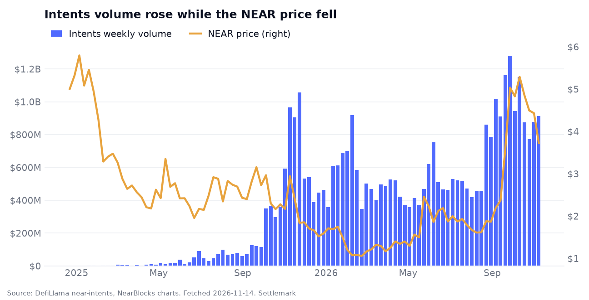
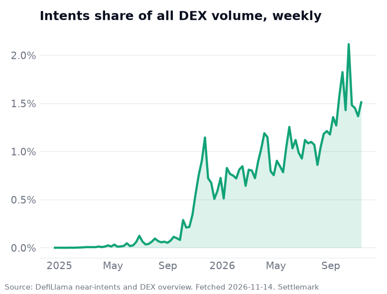
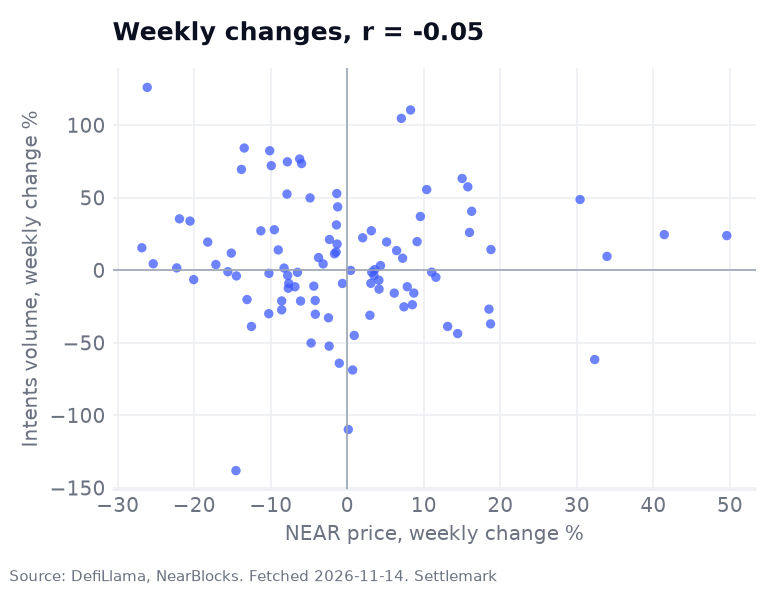

# THESIS: NEAR is becoming a settlement layer, and its token has not caught up

Every number below is computed by `scripts/build.py` from the CSV files in `data/` and written into this file by `scripts/render.py`. Each linked number points at the public API it came from. Data fetched 2026-11-14T22:40:33Z. Window: 2024-12-10 to 2026-11-13 (99 full weeks). Not financial advice.

## The claim

NEAR Intents has turned NEAR into a cross chain settlement layer whose usage grows on its own, independent of the NEAR price. The long term case for NEAR rests on that flow. The weak point today is that the token captures very little of it.

Two parts, tested separately:

1. **Usage is independent of price.** If Intents were just NEAR speculation, its weekly volume would rise and fall with the NEAR price. We expect it not to.
2. **Value capture is small.** The flow is large next to the fees that reach the network and its holders.

## Evidence for

- Weekly NEAR Intents volume went from [$0.8M](https://api.llama.fi/summary/dexs/near-intents?dataType=dailyVolume) a week (first 4 weeks) to [$859.7M](https://api.llama.fi/summary/dexs/near-intents?dataType=dailyVolume) a week (last 4 weeks). Over the same span the NEAR price went from [$5.30](https://api.nearblocks.io/v1/charts) to [$4.38](https://api.nearblocks.io/v1/charts). 
- Intents share of all onchain DEX volume tracked by DefiLlama: [0.003%](https://api.llama.fi/overview/dexs?excludeTotalDataChartBreakdown=true&excludeTotalDataChart=false) in the first 13 weeks, [1.03%](https://api.llama.fi/overview/dexs?excludeTotalDataChartBreakdown=true&excludeTotalDataChart=false) in the 13 weeks before the latest, [1.46%](https://api.llama.fi/overview/dexs?excludeTotalDataChartBreakdown=true&excludeTotalDataChart=false) in the latest 13 weeks. 
- Correlation between weekly changes in Intents volume and weekly NEAR price changes is [-0.05](https://api.llama.fi/summary/dexs/near-intents?dataType=dailyVolume) over 99 weeks (90% bootstrap interval -0.21 to +0.12). That is close to zero. 
- Neither leads the other: last week's NEAR price change against this week's Intents change gives +0.06, and the reverse gives +0.05.
- It is not just crypto beta either: correlation of weekly Intents changes with Bitcoin weekly returns is [-0.08](https://api.coingecko.com/api/v3/coins/bitcoin/market_chart?vs_currency=usd&days=365&interval=daily) over 51 weeks. It does follow the overall DEX market somewhat ([+0.34](https://api.llama.fi/overview/dexs?excludeTotalDataChartBreakdown=true&excludeTotalDataChart=false)), which is what a settlement venue should do.
- Over the last 365 days Intents settled [$32.97B](https://api.llama.fi/summary/dexs/near-intents?dataType=dailyVolume) and charged [$54.3M](https://api.llama.fi/summary/fees/near-intents?dataType=dailyFees) in total fees.

## Evidence against

- **Holders capture little.** Over the last 365 days the Intents protocol kept [$9.4M](https://api.llama.fi/summary/fees/near-intents?dataType=dailyRevenue) as revenue (about 2.8 basis points of volume; all fees were 16.5 basis points). NEAR chain gas fees were [$1.1M](https://api.nearblocks.io/v1/charts). NEAR's market cap is [$4.48B](https://api.nearblocks.io/v1/charts): 477x yearly Intents revenue and 3,906x yearly chain fees. 
- **Levels point the wrong way for holders.** The correlation of log weekly Intents volume with log NEAR price is [-0.52](https://api.nearblocks.io/v1/charts): usage grew while the price fell. Usage alone has not supported the price.
- **The base chain shrank while Intents grew.** NearBlocks daily active accounts averaged [775,618](https://api.nearblocks.io/v1/charts) in the first 13 weeks of the window and [70,872](https://api.nearblocks.io/v1/charts) in the latest 13 weeks. Part of that drop may be bot or airdrop traffic leaving, and relayed signers are undercounted, but it is not the picture of a busier chain. Weekly changes correlate [-0.12](https://api.nearblocks.io/v1/charts) with price changes. 
- **Stablecoins on NEAR shrank:** [$164.5M](https://stablecoins.llama.fi/stablecoincharts/Near) a year ago, [$133.4M](https://stablecoins.llama.fi/stablecoincharts/Near) now. A settlement layer for money should hold more dollars, not fewer. 
- Volume counts can flatter. DefiLlama may count both legs or confidential flow; another entry in this track, [near-thesis](https://github.com/soldanoandrea/near-thesis), found public swaps match only part of DefiLlama's reported volume on sampled days. Our share numbers inherit that.

## What would change our mind

These tests are fixed in `scripts/build.py`. They were written on 2026-11-14, the day of the analysis, so they are not a pre registration made weeks in advance. Met: 0 of 5.

| Falsifier | Test | Result now |
|---|---|---|
| F1 Intents usage moves with NEAR price | weekly change correlation above 0.5 | not met |
| F2 Intents is losing ground | share of all DEX volume, last 13 weeks below the 13 weeks before | not met |
| F3 NEAR price leads Intents usage | lagged correlation above 0.3 | not met |
| F4 Intents is just crypto beta | weekly change correlation with Bitcoin above 0.5 | not met |
| F5 Holders capture the flow | market cap below 50x yearly Intents revenue (if met, the 'small capture' half is wrong) | not met |

We would also change our mind if Intents share of DEX volume falls for two quarters in a row, if the weekly correlation with NEAR price rises above 0.5 over any 26 week window, or if a fee switch or buyback raises holder capture so that market cap falls below 50x yearly revenue (that would make the case bullish rather than conditional).

## Verdict

Part 1 is supported by this data: Intents usage moves independently of the NEAR price and has taken a growing share of onchain DEX volume. Part 2 is also supported, and it is the bear case: the token captures a small slice of that flow, stablecoins on NEAR shrank, and the base chain shows no matching growth. NEAR is a long term buy only if value capture improves. Watch the revenue line in chart 4, not the price.

## Limits

- The one command rebuild uses free public APIs only: DefiLlama, NearBlocks and CoinGecko. The Intents Explorer API was not used (it needs a partner token). BigQuery is the optional path, run by hand (see `docs/BIGQUERY.md`). A cross check on the BigQuery public dataset (`queries/01_receipt_actions_daily.sql`, run by hand in the free sandbox) counted 2,968,076 to 5,144,507 receipt actions a day from 2026-11-08 to 2026-11-13 ([data/bigquery/receipt_actions_daily.csv](data/bigquery/receipt_actions_daily.csv)). It is a 7 day snapshot, so it cannot test a trend yet.
- Correlations of weekly changes over about two years are noisy. The early Intents weeks are tiny, so log changes there are large.
- NearBlocks active accounts can miss signers hidden behind relayers.
- CoinGecko's free tier gives 365 days, so the Bitcoin test covers fewer weeks than the NEAR test.
- If a source changes its methodology, rerunning `make rebuild` changes the numbers. That is intended: nothing here is frozen by hand.
